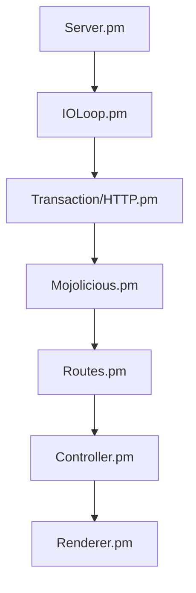

# mojolicious/mojo

> Real-time Perl web framework with a non-blocking HTTP and WebSocket server and a built-in toolkit.

## The problem
Building a Perl web application with WebSockets without assembling disparate modules.

## What it actually does
REST routes, plugins, templates, sessions, validation, static file server, HTTP/WebSocket client, JSON and DOM parsers with CSS selectors. Built-in server with event loop, prefork and hot deployment (Hypnotoad). A single file can grow into an MVC application. Also exists for JavaScript.

## How it is wired
Diagram based on the code diagram.



## Trying it
```bash
curl -L https://cpanmin.us | perl - -M https://cpan.metacpan.org -n Mojolicious
morbo hello.pl
curl http://127.0.0.1:3000/
```

## Cost and gotchas
Free, Artistic-2.0 license. Perl 5.26 recommended (Perl is absent from the prerequisites list). The README recommends Perlbrew and a `curl | perl` that you should review first.

## What it is not
Not a popular framework outside the Perl community; not to be confused with Mojo, the AI language.

## Alternatives
Catalyst, whose experience it builds on (cited in the README).

## For you
Ignore: Perl web, unrelated to data/AI/MLOps.
