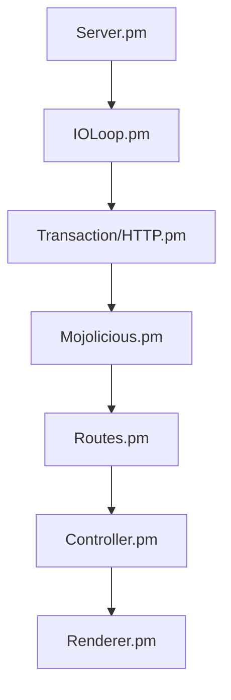

# mojolicious/mojo

> Framework web Perl temps réel avec serveur HTTP et WebSocket non bloquant et boîte à outils intégrée.

## Le problème
Construire une application web Perl avec WebSockets sans assembler des modules disparates.

## Ce que ça fait vraiment
Routes REST, plugins, gabarits, sessions, validation, serveur de fichiers statiques, client HTTP/WebSocket, analyseurs JSON et DOM avec sélecteurs CSS. Serveur intégré avec boucle d'événements, préfork et déploiement à chaud (Hypnotoad). Un fichier unique peut grandir en application MVC. Existe aussi pour JavaScript.

## Comment c'est branché
Schéma d'après le diagramme du code.



## Essayer
```bash
curl -L https://cpanmin.us | perl - -M https://cpan.metacpan.org -n Mojolicious
morbo hello.pl
curl http://127.0.0.1:3000/
```

## Coût et pièges
Gratuit, licence Artistic-2.0. Perl 5.26 recommandé (Perl absent de la liste des prérequis). Le README conseille Perlbrew et un `curl | perl` à relire.

## Ce que ce n'est pas
Pas un framework populaire hors de la communauté Perl ; ne pas confondre avec Mojo, le langage d'IA.

## Alternatives
Catalyst, dont il reprend l'expérience (cité dans le README).

## Pour toi
À ignorer : Perl web, sans lien avec data/IA/MLOps.

