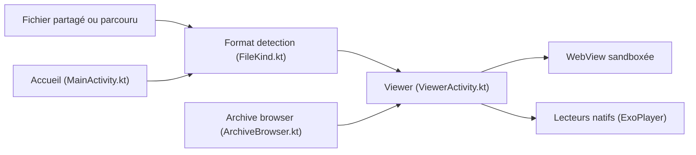

# mokshablr/gander

> Offline Android file viewer, with no permissions and no Internet access, for opening documents and media.

## The problem
Phones have partial viewers that often send documents to cloud services.

## What it actually does
- Opens PDF, Word, Excel, PowerPoint, images, video, audio, Markdown, code and `.zip` archives (read without extraction).
- Document search, night mode, reading resume, printing, sharing, recent folders.
- Renders office formats in a locked-down WebView, with embedded JS libraries (pdf.js, docx-preview, SheetJS…).
- Does not have the INTERNET permission: verifiable in the "About" screen; APK of about 5 MB.

## How it is wired


## Trying it
```bash
apksigner verify --print-certs Gander-x.y.apk
./gradlew assembleDebug
./gradlew assembleRelease
```

## Cost and gotchas
Free. Android 8.0+ and a recent WebView (125 for PDFs). APK signature verifiable via the provided SHA-256 fingerprint. The signing `keystore` file is not versioned.

## What it is not
Not an editor: read-only. Android only. A single-author application.

## Alternatives
No alternative named in the README.

## For you
Ignore: unrelated to data/AI/MLOps; useful only as a private viewer on Android.
