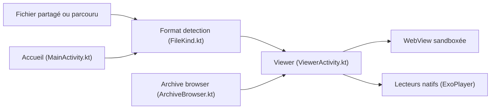

# mokshablr/gander

> Visionneuse de fichiers Android hors ligne, sans permission ni accès Internet, pour ouvrir documents et médias.

## Le problème
Les téléphones ont des visionneuses partielles qui renvoient souvent les documents vers des services cloud.

## Ce que ça fait vraiment
- Ouvre PDF, Word, Excel, PowerPoint, images, vidéo, audio, Markdown, code et archives `.zip` (lues sans extraction).
- Recherche dans le document, mode nuit, reprise de lecture, impression, partage, dossiers récents.
- Rendu des formats bureautiques dans une WebView verrouillée, avec bibliothèques JS embarquées (pdf.js, docx-preview, SheetJS…).
- N'a pas la permission INTERNET : vérifiable dans l'écran « À propos » ; APK d'environ 5 Mo.

## Comment c'est branché


## Essayer
```bash
apksigner verify --print-certs Gander-x.y.apk
./gradlew assembleDebug
./gradlew assembleRelease
```

## Coût et pièges
Gratuit. Android 8.0+ et WebView récente (125 pour les PDF). Signature de l'APK vérifiable via l'empreinte SHA-256 fournie. Le fichier `keystore` de signature n'est pas versionné.

## Ce que ce n'est pas
Pas un éditeur : lecture seule. Android uniquement. Application d'un seul auteur.

## Alternatives
Aucune alternative nommée dans le README.

## Pour toi
À ignorer : sans rapport avec data/IA/MLOps ; utile seulement comme visionneuse privée sur Android.

