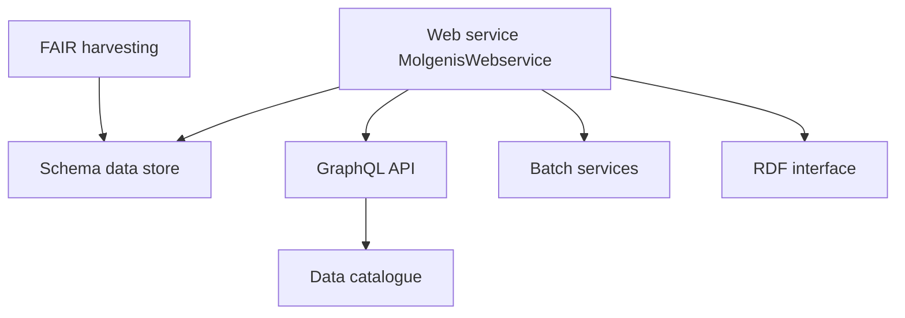

# molgenis/molgenis-emx2

> FAIR scientific data platform that generates a database application from a schema.

## The problem
Research teams manage structured data in scattered spreadsheets, with no entry forms and no shareable query interfaces.

## What it actually does
You describe a schema of tables, columns and relations, and the platform generates an application with forms, import and export, and queries. It exposes PostgreSQL, a GraphQL API, batch services and an RDF/TTL interface. Vue applications cover a catalogue, a biobank directory and dashboards. A FAIR harvesting pipeline and a PID manager exist.

## How it is wired

## Trying it
No command in the README provided: it points to a demo server and to guides for Java with PostgreSQL, docker compose or Kubernetes.

## Cost and gotchas
Java and PostgreSQL for the manual install, or Docker. LGPL-3.0 license, weak copyleft. 454 open issues.

## What it is not
Not an analysis or ML tool: it structures, exposes and shares data. The README describes more capabilities than the observed architecture shows.

## Alternatives
No alternative named in the README.

## For you
Worth watching: useful if you need to organize research data according to FAIR with a GraphQL and RDF API, otherwise it is a heavy platform.
