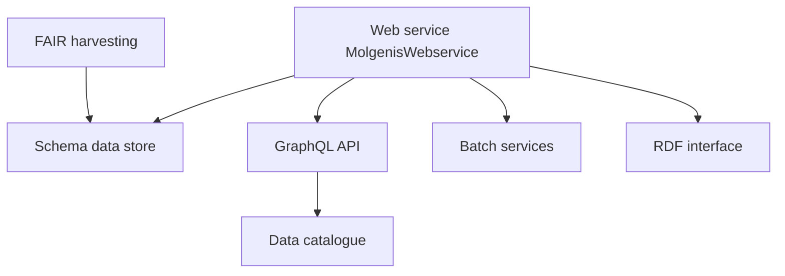

# molgenis/molgenis-emx2

> Plateforme de données scientifiques FAIR qui génère une application de base de données à partir d'un schéma.

## Le problème
Les équipes de recherche gèrent des données structurées dans des tableurs dispersés, sans formulaires de saisie ni interfaces d'interrogation partageables.

## Ce que ça fait vraiment
On décrit un schéma de tables, colonnes et relations, et la plateforme génère une application avec formulaires, import et export, et requêtes. Elle expose PostgreSQL, une API GraphQL, des services batch et une interface RDF/TTL. Des applications Vue couvrent un catalogue, un annuaire de biobanques et des tableaux de bord. Un pipeline de moissonnage FAIR et un gestionnaire de PID existent.

## Comment c'est branché

## Essayer
Aucune commande dans le README fourni : il renvoie à un serveur de démonstration et à des guides pour java avec PostgreSQL, docker compose ou Kubernetes.

## Coût et pièges
Java et PostgreSQL pour l'installation manuelle, ou Docker. Licence LGPL-3.0, copyleft faible. 454 issues ouvertes.

## Ce que ce n'est pas
Pas un outil d'analyse ou de ML : il structure, expose et partage les données. Le README décrit plus de capacités que l'architecture observée n'en montre.

## Alternatives
Aucune alternative nommée dans le README.

## Pour toi
À surveiller : utile si tu dois organiser des données de recherche selon FAIR avec API GraphQL et RDF, sinon c'est une plateforme lourde.

