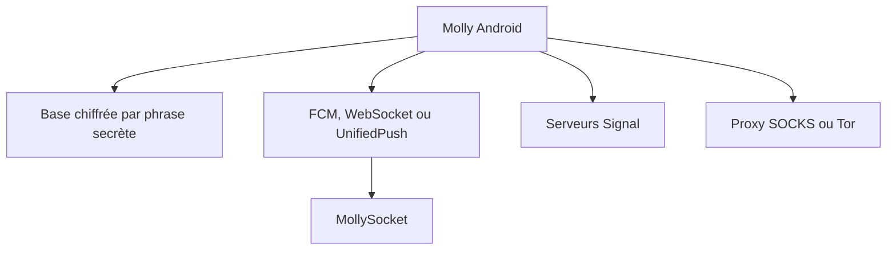

# mollyim/mollyim-android

> Hardened version of Signal for Android, with a passphrase-encrypted database and privacy options.

## The problem
Signal no longer offers a passphrase on the local database and relies on Google software for some features.

## What it actually does
A Signal client that connects to the Signal servers. It adds encryption of the database at rest, a RAM shredder, automatic locking, multiple devices, UnifiedPush, blocking of unknown senders, scheduled backups and a SOCKS or Tor proxy. Two variants: Molly and Molly-FOSS, without proprietary components.

## How it is wired
Simplified diagram based on the sheet, no diagram provided.


## Trying it
```bash
# Pas de commande : installer l'APK depuis les Releases GitHub, le dépôt F-Droid de Molly ou Accrescent.
# Vérifier la signature avec l'empreinte SHA-256 donnée dans le README.
```

## Cost and gotchas
Free, AGPL-3.0. It depends on the Signal servers and their terms. UnifiedPush requires a MollySocket server and is not available for linked devices. 362 open issues.

## What it is not
Not a new protocol: it is a modified Signal client. Builds are reproducible, but the project is not affiliated with the Signal foundation.

## Alternatives
- Signal: the original app, without the hardening options.

## For you
Ignore: hardened mobile messaging, outside the data, AI or MLOps scope.
