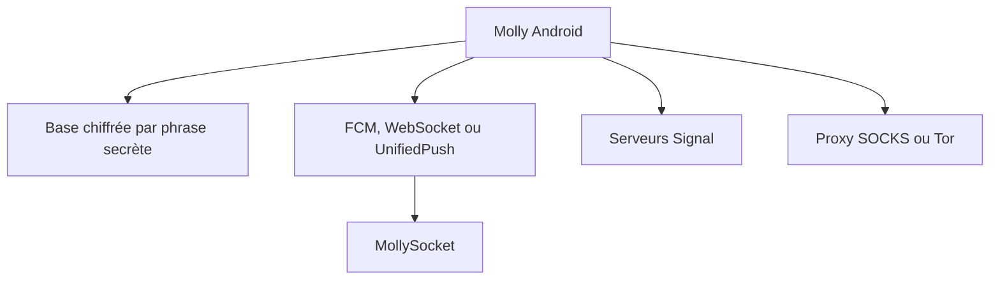

# mollyim/mollyim-android

> Version durcie de Signal pour Android, avec base chiffrée par phrase secrète et options de confidentialité.

## Le problème
Signal ne propose plus de phrase secrète sur la base locale et dépend de logiciels Google pour certaines fonctions.

## Ce que ça fait vraiment
Un client Signal qui se connecte aux serveurs Signal. Il ajoute le chiffrement de la base au repos, un effaceur de mémoire vive, le verrouillage automatique, les appareils multiples, UnifiedPush, le blocage des inconnus, des sauvegardes planifiées et un proxy SOCKS ou Tor. Deux variantes : Molly et Molly-FOSS sans éléments propriétaires.

## Comment c'est branché
Schéma simplifié d'après la fiche, sans diagramme fourni.


## Essayer
```bash
# Pas de commande : installer l'APK depuis les Releases GitHub, le dépôt F-Droid de Molly ou Accrescent.
# Vérifier la signature avec l'empreinte SHA-256 donnée dans le README.
```

## Coût et pièges
Gratuit, AGPL-3.0. Il dépend des serveurs Signal et de ses conditions. UnifiedPush exige un serveur MollySocket, et n'est pas disponible pour les appareils liés. 362 issues ouvertes.

## Ce que ce n'est pas
Pas un nouveau protocole : c'est un client Signal modifié. Les builds sont reproductibles, mais le projet n'est pas affilié à la fondation Signal.

## Alternatives
- Signal : l'application d'origine, sans les options de durcissement.

## Pour toi
À ignorer : messagerie mobile durcie, hors du périmètre data, IA ou MLOps.

