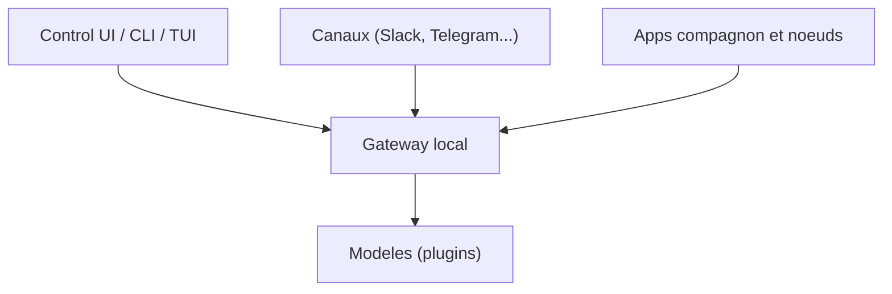

# moltbot/moltbot

> An open-source AI assistant that runs on your machine and responds to messages in your messaging apps (Slack, Telegram, WhatsApp, etc.).

## The problem
AI assistants live within the interface of their editor, not within the channels where you already work. Maintaining memory and credentials requires manually assembling everything.

## What it actually does
A local gateway manages sessions, tools, events, and connections to channels (Discord, iMessage, Slack, Teams, Telegram, WhatsApp, and over 20 others). The control interface, CLI, and TUI connect to it. Companion apps (for macOS, iOS, Android, Windows, and Linux) add voice, Canvas, and camera functionality. The Claude, Codex, and local models are interchangeable plugins.

## How it is wired


## Trying it
```bash
curl -fsSL https://openclaw.ai/install.sh | bash
openclaw onboard --install-daemon
openclaw gateway status
openclaw dashboard
```

## Cost and gotchas
The prompts are sent to the model provider and configured chat platforms: you are responsible for the API costs. The tools run on the host, except for the sandboxed environment; please read the security guide before exposing the Gateway.

## What it is not
Not a standard solution: a vendor is required. Not secure by default against third parties: incoming messages should be treated as untrusted. The README does not specify what "moltbot" refers to in relation to OpenClaw.

## Alternatives
No alternative is specified in the README.

## For you
Things to watch out for: Potentially interesting for a multi-channel personal assistant, but the 7,649 open issues and the need to expose tools on the host system require caution before using it for real MLOps.
