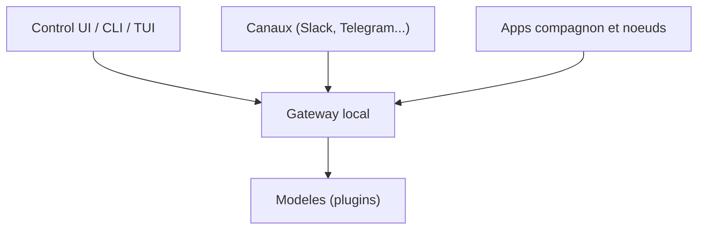

# moltbot/moltbot

> Assistant IA open source qui tourne sur ta machine et répond dans tes messageries (Slack, Telegram, WhatsApp...).

## Le problème
Les assistants IA vivent dans l'interface de leur éditeur, pas dans les canaux où tu travailles déjà. Garder mémoire et identifiants chez soi demande de tout assembler à la main.

## Ce que ça fait vraiment
Un Gateway local pilote sessions, outils, événements et connexions aux canaux (Discord, iMessage, Slack, Teams, Telegram, WhatsApp, 20+ autres). L'interface de contrôle, la CLI et le TUI s'y connectent. Des apps compagnon (macOS, iOS, Android, Windows, Linux) ajoutent voix, Canvas, caméra, écran. Les modèles et harnais (Claude, Codex, modèles locaux) sont des plugins interchangeables.

## Comment c'est branché


## Essayer
```bash
curl -fsSL https://openclaw.ai/install.sh | bash
openclaw onboard --install-daemon
openclaw gateway status
openclaw dashboard
```

## Coût et pièges
Les prompts partent vers le fournisseur de modèle et les plateformes de chat configurés : facture d'API à ta charge. Les outils tournent sur l'hôte sauf sandboxing configuré ; lire le guide de sécurité avant d'exposer le Gateway.

## Ce que ce n'est pas
Pas un modèle : il faut un fournisseur. Pas sécurisé par défaut face à des tiers : les messages entrants sont à traiter comme non fiables. Le README ne dit pas ce que le nom moltbot recouvre par rapport à OpenClaw.

## Alternatives
Aucune alternative nommée dans le README.

## Pour toi
À surveiller : intéressant pour un assistant perso multi-canaux, mais 7 649 issues ouvertes et l'exposition des outils sur l'hôte demandent de la prudence avant tout usage MLOps réel.

