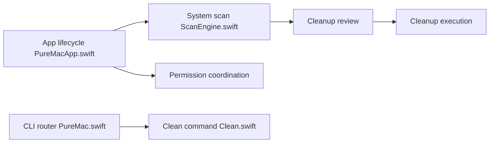

# momenbasel/PureMac

> Free macOS app for cleaning, uninstalling apps and exploring storage, with no telemetry.

## The problem
Mac cleaners are often paid, intrusive and alarmist.

## What it actually does
Uninstaller with 10 matching levels, orphan detection in `~/Library`, cleanup (caches, Xcode, Homebrew, npm, Docker), space explorer, duplicates by SHA-256, similar photos, protection audit, scheduled cleanup. A CLI separates preview mode (`--dry-run`) from execution.

## How it is wired


## Trying it
```bash
brew install --cask puremac
brew install momenbasel/tap/puremac-cli
puremac clean dev --dry-run
```

## Cost and gotchas
Free. Requests full disk access. Some cleanups delete permanently; scheduled cleanup stays automatic once enabled.

## What it is not
Not an antivirus: the protection audit is a configuration check. Does not claim to free "purgeable" space. Comparisons with CleanMyMac written by the author.

## Alternatives
CleanMyMac, Pearcleaner, Mole, OnyX: compared in the README.

## For you
Ignore: macOS utility unrelated to data/AI/MLOps work, except to reclaim disk space on a dev machine.
