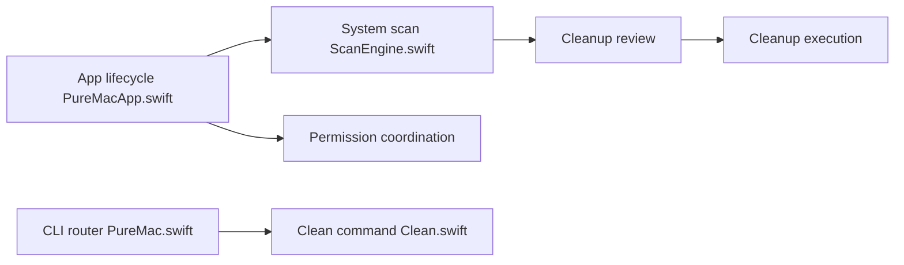

# momenbasel/PureMac

> Application macOS gratuite de nettoyage, désinstallation d'apps et exploration du stockage, sans télémétrie.

## Le problème
Les nettoyeurs de Mac sont souvent payants, intrusifs et alarmistes.

## Ce que ça fait vraiment
Désinstalleur avec 10 niveaux de correspondance, détection d'orphelins dans `~/Library`, nettoyage (caches, Xcode, Homebrew, npm, Docker), explorateur d'espace, doublons par SHA-256, photos similaires, audit de protection, nettoyage planifié. Une CLI sépare le mode aperçu (`--dry-run`) de l'exécution.

## Comment c'est branché


## Essayer
```bash
brew install --cask puremac
brew install momenbasel/tap/puremac-cli
puremac clean dev --dry-run
```

## Coût et pièges
Gratuit. Demande l'accès complet au disque. Certains nettoyages suppriment définitivement ; le nettoyage planifié reste automatique une fois activé.

## Ce que ce n'est pas
Pas un antivirus : l'audit de protection est une vérification de configuration. N'affirme pas libérer l'espace « purgeable ». Comparaisons avec CleanMyMac écrites par l'auteur.

## Alternatives
CleanMyMac, Pearcleaner, Mole, OnyX : comparés dans le README.

## Pour toi
À ignorer : utilitaire macOS sans rapport avec un travail data/IA/MLOps, sauf pour récupérer de l'espace disque sur un poste de dev.

