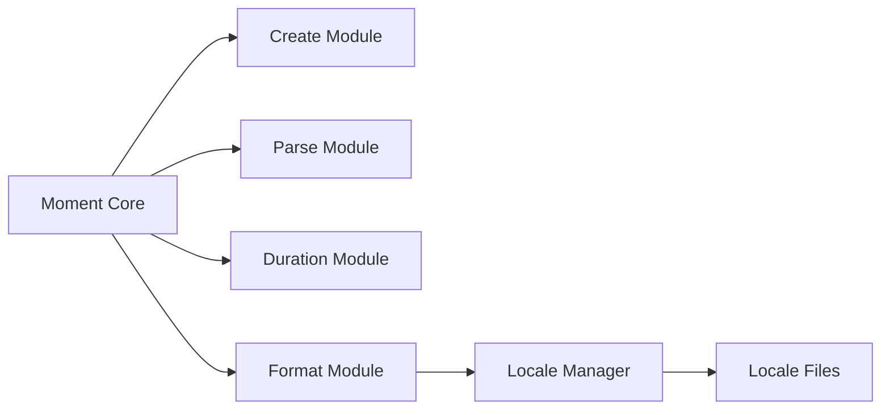

# moment/moment

> JavaScript date library, in maintenance mode, for existing code.

## The problem
Parsing, validating, manipulating and formatting dates in JavaScript.

## What it actually does
Minimal README (under 800 characters). It states that this is a legacy project, in maintenance mode, under the OpenJS Foundation, with no new features. The code covers creation/parsing, durations, formatting and locales.

## How it is wired

The architecture text is an assumed drawing guide.

## Trying it
```bash
npm install moment
```

## Cost and gotchas
Free. Legacy project: the README points to a status note, and no new features are accepted.

## What it is not
Not a choice for a new project. Minimal sheet: the README details neither the API nor alternatives.

## Alternatives
No alternative named in the README.

## For you
Ignore for new work: the project is in maintenance and no longer accepts features; keep it only for code already in place.
