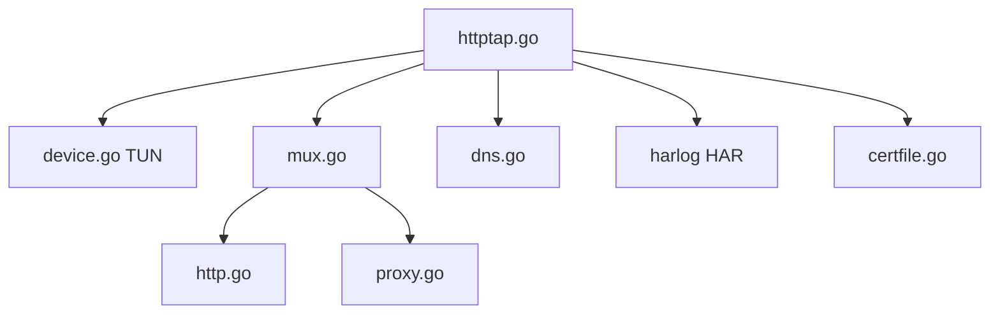

# monasticacademy/httptap

> Go binary that shows the HTTP(S) requests of any Linux program, with no root and no daemon.

## The problem
Finding out which HTTP requests a program really sends requires a proxy to configure or root access, and some programs ignore proxies.

## What it actually does
Runs a command in an isolated network namespace connected to a TUN device, implements a TCP/IP stack in software, relays to the real network and decrypts HTTPS with a certificate authority generated on the fly, visible only to the subprocess. Displays requests and responses, with `--head` and `--body` options, and HAR export.

## How it is wired


## Trying it
```shell
curl -L https://github.com/monasticacademy/httptap/releases/latest/download/httptap_linux_$(uname -m).tar.gz | tar xzf -
go install github.com/monasticacademy/httptap@latest
httptap -- curl https://monasticacademy.org
httptap --head --body -- curl -sL https://monasticacademy.org
httptap --dump-har out.har -- curl -Lso /dev/null https://monasticacademy.org
```

## Cost and gotchas
Free. Linux only, access to `/dev/net/tun` required. Ubuntu 23.10+: two `sysctl` settings to disable. Clients that do not use the system certificate store require a TLS-ignore flag.

## What it is not
Not a system proxy: it affects no other process. Not portable outside Linux. The TCP/IP stack is incomplete, cannot listen for incoming connections, and pings are simulated.

## Alternatives
No alternative named in the README.

## For you
Adopt: handy for debugging what an SDK, a cloud CLI or a Python script does, without modifying the machine; MIT and simple.
