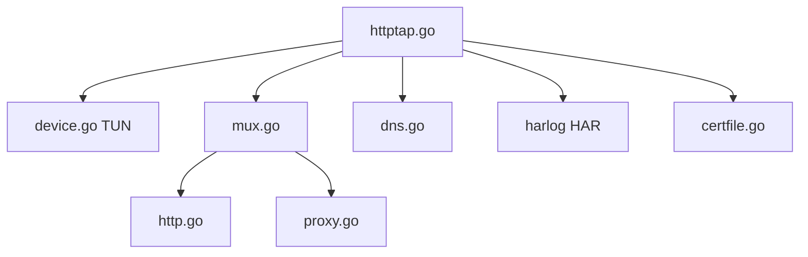

# monasticacademy/httptap

> Binaire Go qui affiche les requêtes HTTP(S) de tout programme Linux, sans root ni démon.

## Le problème
Savoir quelles requêtes HTTP un programme émet réellement exige un proxy à configurer ou un accès root, et certains programmes ignorent les proxys.

## Ce que ça fait vraiment
Lance une commande dans un espace de noms réseau isolé relié à un périphérique TUN, implémente une pile TCP/IP en logiciel, relaie vers le réseau réel et déchiffre le HTTPS avec une autorité de certification générée à la volée, visible seulement du sous-processus. Affiche requêtes et réponses, option `--head` et `--body`, export HAR.

## Comment c'est branché


## Essayer
```shell
curl -L https://github.com/monasticacademy/httptap/releases/latest/download/httptap_linux_$(uname -m).tar.gz | tar xzf -
go install github.com/monasticacademy/httptap@latest
httptap -- curl https://monasticacademy.org
httptap --head --body -- curl -sL https://monasticacademy.org
httptap --dump-har out.har -- curl -Lso /dev/null https://monasticacademy.org
```

## Coût et pièges
Gratuit. Linux seulement, accès à `/dev/net/tun` requis. Ubuntu 23.10+ : deux `sysctl` à désactiver. Les clients qui n'utilisent pas le magasin de certificats du système exigent un drapeau d'ignorance TLS.

## Ce que ce n'est pas
Pas un proxy système : n'affecte aucun autre processus. Pas portable hors Linux. La pile TCP/IP est incomplète, ne peut pas écouter de connexions entrantes, et les ping sont simulés.

## Alternatives
Aucune alternative nommée dans le README.

## Pour toi
À adopter : pratique pour déboguer ce que font un SDK, un CLI cloud ou un script Python, sans modifier la machine ; MIT et simple.

