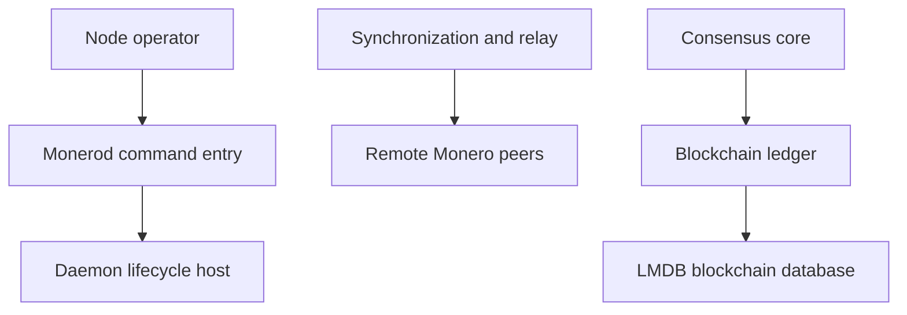

# monero-project/monero

> Reference C++ implementation of the Monero digital currency, node and wallet, for operators and developers.

## The problem
Exchanging value without a central bank, with transactions hidden by default on a peer-to-peer network.

## What it actually does
The `monerod` daemon synchronizes with the network, validates and stores the chain in LMDB, and relays blocks and transactions. A wallet and a JSON-RPC client come with it. The README also describes the consensus upgrade schedule and building on many systems.

## How it is wired


## Trying it
```bash
git clone --recursive https://github.com/monero-project/monero
cd monero
git checkout release-v0.18
make
monerod --detach
```

## Cost and gotchas
Free. Long build: about one core and 2 GB of RAM per thread, plus Boost, OpenSSL, ZeroMQ and Rust 1.85; `core_tests` can take hours. License present but not identified by GitHub: to be checked.

## What it is not
Not a turnkey project: the master branch can be unstable, the README recommends a tagged release. It has no use for AI.

## Alternatives
No alternative named in the README.

## For you
Ignore: a cryptocurrency node is not data, AI or MLOps.
