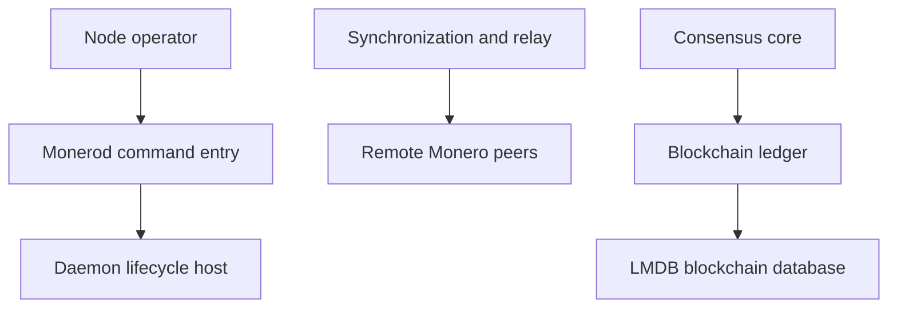

# monero-project/monero

> Implémentation de référence en C++ de la monnaie numérique Monero, nœud et portefeuille, pour opérateurs et développeurs.

## Le problème
Échanger de la valeur sans banque centrale, avec des transactions masquées par défaut sur un réseau pair à pair.

## Ce que ça fait vraiment
Le démon `monerod` se synchronise avec le réseau, valide et stocke la chaîne dans LMDB, et relaie blocs et transactions. Un portefeuille et un client JSON-RPC y sont associés. Le README décrit aussi le calendrier des mises à jour de consensus et la compilation sur de nombreux systèmes.

## Comment c'est branché


## Essayer
```bash
git clone --recursive https://github.com/monero-project/monero
cd monero
git checkout release-v0.18
make
monerod --detach
```

## Coût et pièges
Gratuit. Compilation longue : environ un cœur et 2 Go de RAM par thread, plus Boost, OpenSSL, ZeroMQ et Rust 1.85 ; `core_tests` peut durer des heures. Licence présente mais non identifiée par GitHub : à vérifier.

## Ce que ce n'est pas
Ce n'est pas un projet clé en main : la branche master peut être instable, le README recommande une version étiquetée. Il ne sert pas à l'IA.

## Alternatives
Aucune alternative nommée dans le README.

## Pour toi
Ignorer : un nœud de cryptomonnaie ne relève ni de la data, ni de l'IA, ni du MLOps.

