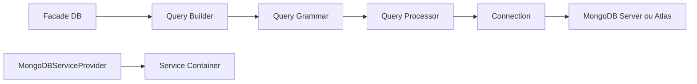

# mongodb/laravel-mongodb

> Official Laravel extension that runs Eloquent and the query builder on MongoDB.

## The problem
Eloquent is designed for SQL: without an adapter, a Laravel project cannot use MongoDB with the same API.

## What it actually does
Extends Laravel's Eloquent classes and query builder so they talk to MongoDB with the same methods. According to the code, it also provides a schema builder for migrations, cache, queue and session drivers, a Scout engine for Atlas search, a presence verifier for validation and a repository for job batches.

## How it is wired


## Trying it
```bash
gpg --import php-driver.asc
git show --show-signature 4.4.0
```
No install command in the README: see MongoDB's online documentation.

## Cost and gotchas
Free, but you need a MongoDB server or an Atlas cluster. The README says compatible with Laravel 10.x; older versions have their own branch. Bugs are reported in a JIRA, not in GitHub issues.

## What it is not
Not a data or AI tool: it is a building block for PHP web applications. It does not replace the PHP MongoDB driver, it relies on it.

## Alternatives
No alternative named in the README.

## For you
Ignore for a data / AI / MLOps profile, unless you maintain a Laravel application on MongoDB: it is then the official route.
