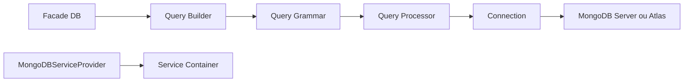

# mongodb/laravel-mongodb

> Extension officielle de Laravel qui fait tourner Eloquent et le query builder sur MongoDB.

## Le problème
Eloquent est pensé pour le SQL : sans adaptateur, un projet Laravel ne peut pas utiliser MongoDB avec la même API.

## Ce que ça fait vraiment
Étend les classes Eloquent et le query builder de Laravel pour qu'elles parlent à MongoDB avec les mêmes méthodes. D'après le code, il fournit aussi un schema builder pour les migrations, des pilotes de cache, de file d'attente, de session, un moteur Scout pour la recherche Atlas, un vérificateur de présence pour la validation et un dépôt pour les lots de jobs.

## Comment c'est branché


## Essayer
```bash
gpg --import php-driver.asc
git show --show-signature 4.4.0
```
Aucune commande d'installation dans le README : voir la documentation en ligne de MongoDB.

## Coût et pièges
Gratuit, mais il faut un serveur MongoDB ou un cluster Atlas. Le README dit compatible Laravel 10.x ; les anciennes versions ont leur propre branche. Les bugs se déclarent dans un JIRA, pas dans les issues GitHub.

## Ce que ce n'est pas
Ce n'est pas un outil data ou IA : c'est une brique pour applications web PHP. Elle ne remplace pas le pilote PHP MongoDB, elle s'appuie dessus.

## Alternatives
Aucune alternative nommée dans le README.

## Pour toi
À ignorer pour un profil data / IA / MLOps, sauf si tu maintiens une application Laravel sur MongoDB : c'est alors la voie officielle.

