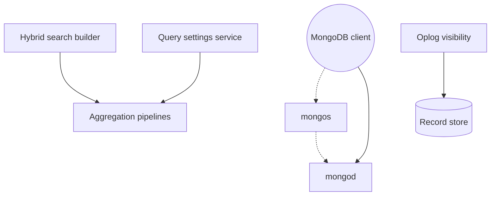

# mongodb/mongo

> Source code of the MongoDB document database server, with its sharding router.

## The problem
Store flexible documents at scale with replication and sharding, without a rigid schema.

## What it actually does
Provides `mongod` (server) and `mongos` (sharding router). The README points to the downloads, the mongosh shell, Compass and the drivers. From the code: a query settings service, a hybrid search builder, a query analysis client and oplog visibility management.

## How it is wired


## Trying it
```bash
docker pull mongodb/mongodb-community-server
sudo mkdir -p /data/db
./mongod
./mongosh
```

## Cost and gotchas
Community edition is free; the Atlas cloud is paid. Compiling the server is heavy; packages are produced by `buildscripts/packager.py`.

## What it is not
Not a simple tool: a server to operate. License not identified by GitHub, to be checked before commercial use or a hosted service.

## Alternatives
None named in the README.

## For you
Worth watching: a common database in data pipelines, but check the license if you embed it in a service.
