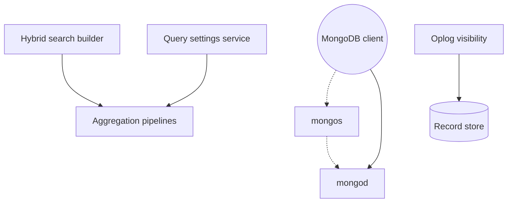

# mongodb/mongo

> Code source du serveur de base de données documentaire MongoDB, avec son routeur de sharding.

## Le problème
Stocker des documents flexibles à grande échelle avec réplication et sharding sans schéma rigide.

## Ce que ça fait vraiment
Fournit `mongod` (serveur) et `mongos` (routeur de sharding). Le README renvoie vers les téléchargements, le shell mongosh, Compass et les drivers. D'après le code : un service de paramètres de requêtes, un constructeur de recherche hybride, un client d'analyse de requêtes et une gestion de la visibilité de l'oplog.

## Comment c'est branché


## Essayer
```bash
docker pull mongodb/mongodb-community-server
sudo mkdir -p /data/db
./mongod
./mongosh
```

## Coût et pièges
Édition communautaire gratuite ; le cloud Atlas est payant. Compiler le serveur est lourd ; les paquets sont produits par `buildscripts/packager.py`.

## Ce que ce n'est pas
Pas un simple outil : un serveur à exploiter. Licence non identifiée par GitHub, à vérifier avant usage commercial ou service hébergé.

## Alternatives
Aucune nommée dans le README.

## Pour toi
À surveiller : base courante en pipelines de données, mais vérifie la licence si tu l'embarques dans un service.

