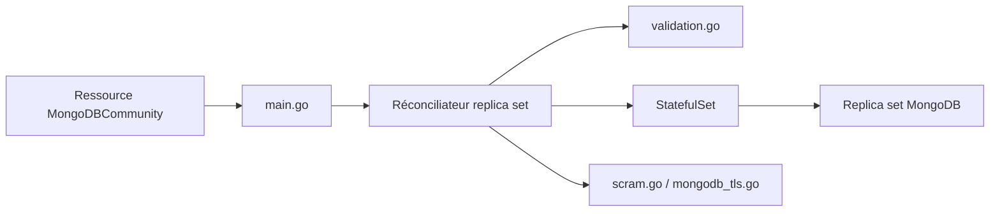

# mongodb/mongodb-kubernetes-operator

> Kubernetes operator (community edition) that deploys MongoDB replica sets; deprecated repository.

## The problem
Running a MongoDB replica set on Kubernetes (upgrades, users, TLS) requires a lot of manual operations.

## What it actually does
A user declares a `MongoDBCommunity` resource; the operator reconciles it into StatefulSets and services, configures the replica set through the MongoDB agent, and publishes the status. It handles version changes, scaling, SCRAM users, custom roles, X.509, TLS and Prometheus metrics.

## How it is wired

## Trying it
The README documents no commands: it points to the official documentation for installation.

## Cost and gotchas
Free, but "best effort" support was due to end in November 2025. The repository is archived.

## What it is not
Not the Enterprise operator (separate documentation). Not maintained: the README says to move to `mongodb/mongodb-kubernetes`.

## Alternatives
- mongodb/mongodb-kubernetes: the new repository pointed to by MongoDB.

## For you
Ignore: archived and deprecated; go straight to the replacement repository.
