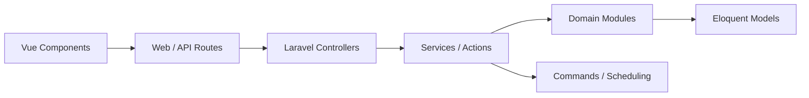

# monicahq/monica

> Open source personal CRM to document your loved ones, contacts, reminders and journal.

## The problem
We forget details about the lives of the people we love: birthdays, conversations, relationships.

## What it actually does
Web application (Laravel + Vue): contacts, relationships, reminders, notes, activities, tasks, journal, documents and photos, multiple vaults and users, 27 languages. No AI, no social network, no tracking. The main branch is a beta version; the stable one is 4.x.

## How it is wired

## Trying it
No command documented in the README; see the developer installation guide.

## Cost and gotchas
Free, self-hosted. SMTP mail must be configured for reminders. 791 open issues, main branch in beta.

## What it is not
Not an intelligent assistant nor a social tool. AGPL-3.0: obligations if you host it for others.

## Alternatives
No alternative named in the README.

## For you
Unrelated to your data/AI work; it is a personal app, to be ignored unless you have a private need.
