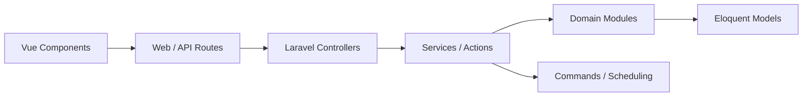

# monicahq/monica

> CRM personnel open source pour documenter ses proches, contacts, rappels et journal.

## Le problème
On oublie les détails de la vie des gens qu'on aime : anniversaires, conversations, relations.

## Ce que ça fait vraiment
Application web (Laravel + Vue) : contacts, relations, rappels, notes, activités, tâches, journal, documents et photos, plusieurs coffres et utilisateurs, 27 langues. Pas d'IA, pas de réseau social, pas de suivi. La branche principale est une version bêta ; la stable est la 4.x.

## Comment c'est branché

## Essayer
Aucune commande documentée dans le README ; voir le guide d'installation du développeur.

## Coût et pièges
Gratuit, auto-hébergé. Mail SMTP à configurer pour les rappels. 791 issues ouvertes, branche principale en bêta.

## Ce que ce n'est pas
Pas un assistant intelligent ni un outil social. AGPL-3.0 : obligations si tu l'héberges pour d'autres.

## Alternatives
Aucune alternative nommée dans le README.

## Pour toi
Sans lien avec ton métier data/IA ; c'est une app personnelle, à ignorer sauf besoin privé.

