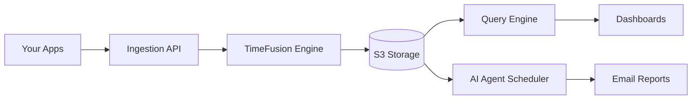

# monoscope-tech/monoscope

> An observability platform that stores logs, traces and metrics in your S3 buckets, with natural-language queries.

## The problem
Keeping years of telemetry is expensive with proprietary observability vendors, and exploring it remains tedious.

## What it actually does
OpenTelemetry ingestion, storage in S3 buckets via TimeFusion (the authors' time-series database, Postgres-compatible), log and trace exploration, natural-language queries via LLM, scheduled anomaly-detection agents with e-mail reports, CLI, MCP server and skills for Claude Code. Server written in Haskell. The figures (500K+ events/s) and the comparison table are the authors' own.

## How it is wired


## Trying it
```bash
git clone https://github.com/monoscope-tech/monoscope.git
cd monoscope
docker-compose up
monoscope auth login
monoscope send-event -m "Hello from Monoscope"
```

## Cost and gotchas
Self-hosting is free (AGPL-3.0) with the S3 bucket at your expense; the cloud is usage-based and the free tier has only one user. The LLM features call an external model (unspecified). Default credentials `admin/changeme`. The README contains an unclosed code block (CLI section).

## What it is not
Not a simple log tool: self-hosting includes neither SSO nor advanced alerts (Slack, PagerDuty are reserved for the cloud). AGPL: obligations if you run a hosted service.

## Alternatives
Datadog, Elastic and Prometheus (comparison table in the README).

## For you
Worth watching: interesting for observing ML pipelines at low cost on S3; the AI part requires an external model and the comparison table comes from the authors.
