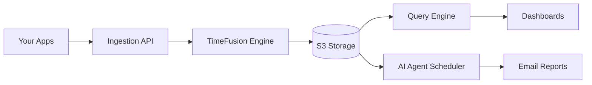

# monoscope-tech/monoscope

> Plateforme d'observabilité stockant logs, traces et métriques dans tes buckets S3, avec requêtes en langage naturel.

## Le problème
Conserver des années de télémétrie coûte cher chez les éditeurs d'observabilité propriétaires, et l'exploration reste fastidieuse.

## Ce que ça fait vraiment
Ingestion OpenTelemetry, stockage dans des buckets S3 via TimeFusion (base de séries temporelles des auteurs, compatible Postgres), exploration de logs et traces, requêtes en langage naturel par LLM, agents planifiés de détection d'anomalies avec rapports par e-mail, CLI, serveur MCP et skills pour Claude Code. Serveur écrit en Haskell. Les chiffres (500K+ événements/s) et le tableau comparatif sont ceux des auteurs.

## Comment c'est branché


## Essayer
```bash
git clone https://github.com/monoscope-tech/monoscope.git
cd monoscope
docker-compose up
monoscope auth login
monoscope send-event -m "Hello from Monoscope"
```

## Coût et pièges
Auto-hébergement gratuit (AGPL-3.0) avec bucket S3 à ta charge ; le cloud est à l'usage et l'offre gratuite n'a qu'un utilisateur. Les fonctions LLM appellent un modèle externe (non précisé). Identifiants par défaut `admin/changeme`. Le README contient un bloc de code non refermé (section CLI).

## Ce que ce n'est pas
Pas un simple outil de logs : l'auto-hébergement n'inclut ni SSO ni alertes avancées (Slack, PagerDuty réservés au cloud). AGPL : obligations en cas de service hébergé.

## Alternatives
Datadog, Elastic et Prometheus (tableau comparatif du README).

## Pour toi
Surveiller : intéressant pour observer des pipelines ML à bas coût sur S3 ; la partie IA exige un modèle externe et le tableau comparatif vient des auteurs.

