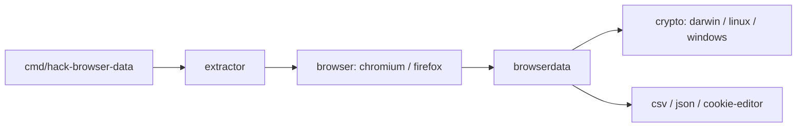

# moonD4rk/HackBrowserData

> Go command-line tool that decrypts and exports browser data, for security research analysts.

## The problem
Analyzing a machine during an investigation or audit requires reading encrypted browser data, specific to each browser and system. The tool unifies this reading.

## What it actually does
- Reads and decrypts passwords, cookies, history, bookmarks, cards, downloads, localStorage, sessionStorage and extensions.
- Covers Chromium and Firefox browsers on Windows, macOS, Linux, and Safari on macOS.
- A "cross-host" mode separates key export, data archiving and offline decryption on another analysis machine.
- Outputs in CSV, JSON or Cookie-Editor format.

## How it is wired


## Trying it
```bash
hack-browser-data list
hack-browser-data version
```
Only run it on a machine and accounts you control or have written authorization for. The extraction commands are described in the README (`dump`, `dumpkeys`, `archive`, `restore`).

## Cost and gotchas
Free. Antivirus software flags it as malicious, as the README acknowledges. The `keys.json` file contains keys in clear text: it is a secret. Decrypting Chromium 127+ cookies on Windows requires a build with Zig.

## What it is not
It is not a neutral tool: the same function serves legitimate analysis and credential theft. The README limits it to security research and disclaims all liability; unauthorized access to other people's data is illegal.

## Alternatives
No alternative named in the README.

## For you
Outside the data/AI scope; worth watching only if you do incident response or auditing, with an explicit legal framework.
