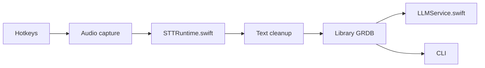

# moona3k/macparakeet

> Local macOS app for dictation, file transcription and meeting recording on Apple Silicon.

## The problem
Transcription tools send audio to the cloud; fast, local system dictation is rare.

## What it actually does
Global dictation via a hotkey (the text is pasted), transcription of files, URLs and podcasts (exports to TXT, SRT, DOCX, PDF, JSON…), and meeting recording of microphone + system audio with calendar integration. Local engines: Parakeet v3 by default, plus v2, Nemotron Beta, Cohere, WhisperKit. Optional AI (summaries, chat, Transforms) through the provider of your choice. A `macparakeet-cli` CLI for automation.

## How it is wired


## Trying it
```bash
brew install --cask macparakeet
brew install moona3k/tap/macparakeet-cli
macparakeet-cli transcribe /path/to/audio.mp3
```

## Cost and gotchas
Free; model downloads (~465 MB + ~130 MB). Cohere requires 16 GB+ of RAM. Telemetry is enabled by default (even in a source build); the Discover feed calls macparakeet.com at launch.

## What it is not
Not cross-platform: Apple Silicon, macOS 14.2+. Parakeet v3 fails on CJK/Korean. License not identified by GitHub.

## Alternatives
- WhisperKit and Cohere Transcribe: built in as alternative engines.

## For you
Worth watching: very complete for local transcription on Mac and well benchmarked, but check the license and turn off telemetry.
