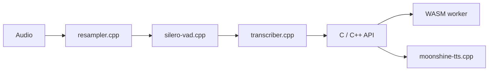

# moonshine-ai/moonshine

> Local streaming speech recognition toolkit for voice agents and applications.

## The problem
Voice agents depend on cloud APIs: latency, cost, privacy.

## What it actually does
Runs on-device, with no account or API key. Transcription models trained from scratch, from the most accurate (better than Whisper Large V3 according to the README) down to 1 MB. A C/C++ runtime handles streaming transcription, voice activity detection (Silero), resampling, diarization, speech synthesis and embeddings. Bindings: Python, JavaScript/WASM, iOS, Android, desktop, Raspberry Pi.

## How it is wired


## Trying it
```bash
pip install moonshine-voice
moonshine-voice mic --language en
```

## Cost and gotchas
Free, no key. License present but not identified by GitHub: to be verified (the models may have a separate license, not specified).

## What it is not
The accuracy figures are the README's own, not verified. Not a hosted service.

## Alternatives
- Whisper: cited as the accuracy reference; Moonshine targets streaming latency.

## For you
Adopt to try local transcription: one command is enough, but check the models' license before any commercial use.
