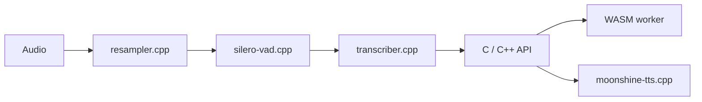

# moonshine-ai/moonshine

> Boîte à outils locale de reconnaissance vocale en flux pour agents vocaux et applications.

## Le problème
Les agents vocaux dépendent d'API cloud : latence, coût, confidentialité.

## Ce que ça fait vraiment
Tourne sur l'appareil, sans compte ni clé d'API. Modèles de transcription entraînés de zéro, du plus précis (supérieur à Whisper Large V3 selon le README) à 1 Mo. Un runtime C/C++ gère transcription en flux, détection de voix (Silero), rééchantillonnage, diarisation, synthèse vocale et embeddings. Bindings : Python, JavaScript/WASM, iOS, Android, desktop, Raspberry Pi.

## Comment c'est branché


## Essayer
```bash
pip install moonshine-voice
moonshine-voice mic --language en
```

## Coût et pièges
Gratuit, sans clé. Licence présente mais non identifiée par GitHub : à vérifier (les modèles peuvent avoir une licence distincte, non précisée).

## Ce que ce n'est pas
Les chiffres de précision sont ceux du README, non vérifiés. Pas un service hébergé.

## Alternatives
- Whisper : cité comme référence de précision ; Moonshine vise la latence en flux.

## Pour toi
À adopter pour essayer de la transcription locale : une commande suffit, mais vérifie la licence des modèles avant tout usage commercial.

