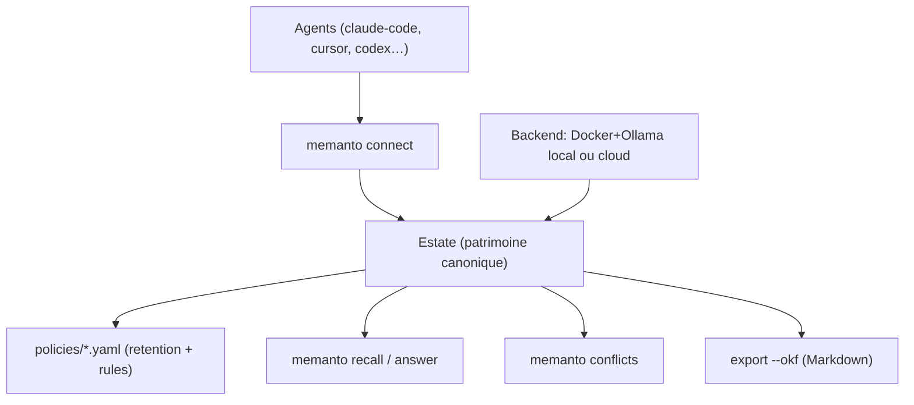

# moorcheh-ai/memanto

> Companion agent that manages the memory of other agents: what to keep, what to expire, who to inform.

## The problem
Every platform stores agent memory; none tells you that two of them now believe the opposite of each other about your auth service.

## What it actually does
Six behaviors, each behind a command. It observes interaction streams and extracts what is durable (`memanto remember --from-conversation`), consolidates into a canonical estate (`memanto schedule enable`), reconciles by replacing rather than stacking (`memanto conflicts`), forgets according to policies written in YAML (`memanto forget`), briefs an agent before it acts (`memanto agent bootstrap`), and exports in the open OKF format — readable, diffable, committable Markdown (`memanto memory export --okf`). 13 typed memory categories. Temporal recall with `--as-of` and `--changed-since`.

## How it is wired


## Trying it
```bash
pip install memanto
memanto                            # "On-Prem" (Docker, no account) or "Cloud" (free key)
memanto connect claude-code
memanto remember "Auth migrated to JWT — session cookies deprecated" --type decision
memanto recall "how does auth work"
memanto policy apply --dry-run
memanto ui
```

## Cost and gotchas
MIT, two backends: fully local (Docker + Ollama, nothing leaves the machine) or free cloud with a key and 100,000 free operations on console.moorcheh.ai. Local mode requires Docker. The README still contains an unfilled TODO block in the security section, and the demo section flags a missing GIF: the project is young.

## What it is not
Not a vector store or a persistence SDK: the storage substrates sit underneath, Memanto is the judgment layer on top. The announced benchmarks (89.8% LongMemEval, 87.1% LoCoMo) are put in perspective by the authors themselves: they write that cross-project scores are not comparable and should be read as directional.

## Alternatives
- Mem0, Letta, Supermemory: cited as import sources via `memanto migrate`, hence direct competitors on memory storage.

## For you
Worth following if you run several agents that must share the same state of knowledge.
