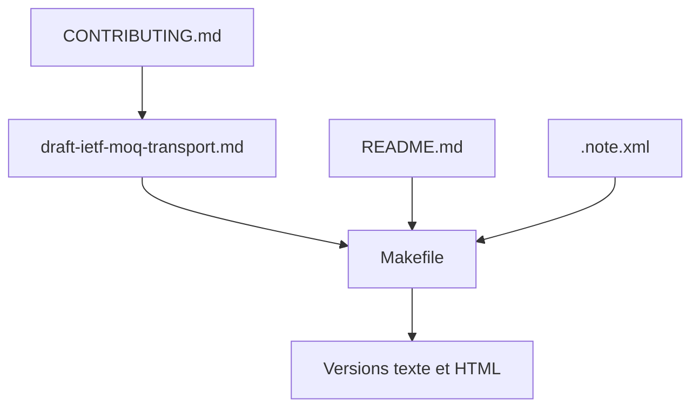

# moq-wg/moq-transport

> IETF draft of the "Media over QUIC Transport" protocol, written in Markdown.

## The problem
Real-time media transport over QUIC is not yet standardized.

## What it actually does
The repository is the working area of the IETF MOQ group. The text is `draft-ietf-moq-transport.md`, which the `Makefile` turns into text and HTML versions.

## How it is wired
Diagram based on the code diagram.



## Trying it
```bash
make
```

## Cost and gotchas
Free. The i-d-template tooling must be installed. License not identified by GitHub.

## What it is not
Not an implementation: only the specification, still at draft stage.

## Alternatives
None cited in the README.

## For you
Ignore: a media-streaming network specification, with no direct relation to data / AI / MLOps work.
