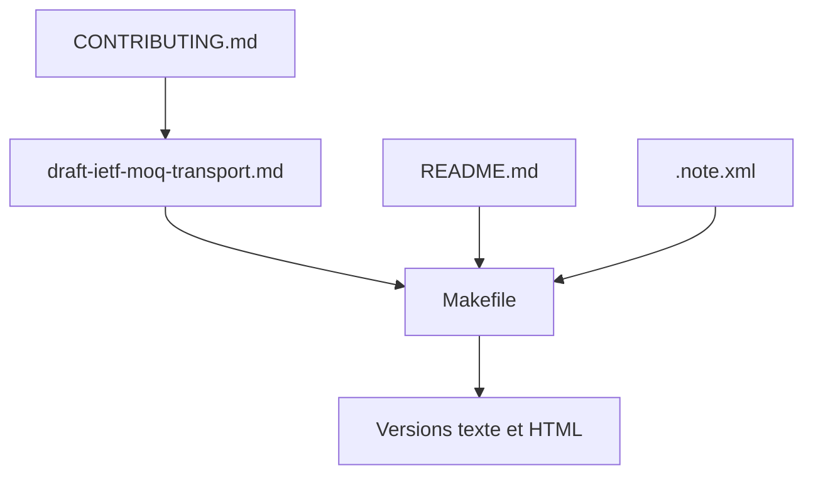

# moq-wg/moq-transport

> Brouillon IETF du protocole « Media over QUIC Transport », rédigé en Markdown.

## Le problème
Le transport de médias en temps réel sur QUIC n'est pas encore normalisé.

## Ce que ça fait vraiment
Le dépôt est la zone de travail du groupe MOQ de l'IETF. Le texte est `draft-ietf-moq-transport.md`, que le `Makefile` transforme en versions texte et HTML.

## Comment c'est branché
Schéma d'après le diagramme du code.



## Essayer
```bash
make
```

## Coût et pièges
Gratuit. L'outillage i-d-template doit être installé. Licence non identifiée par GitHub.

## Ce que ce n'est pas
Pas une implémentation : seulement la spécification, encore à l'état de brouillon.

## Alternatives
Aucune citée dans le README.

## Pour toi
Ignorer : spécification réseau de diffusion de médias, sans rapport direct avec un travail data / IA / MLOps.

