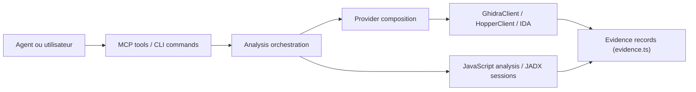

# morluto/rea

> MCP and CLI server that allows an agent to analyze local files, including Electron apps, APKs, and websites.

## The problem
Understanding how a feature in a closed-source application is built requires manually chaining together disassemblers, format inspectors, and network captures.

## What it actually does
REA exposes a large table of targets through MCP and CLI: native binaries (Hopper, Ghidra or IDA), JavaScript/Electron, .NET, APK (JADX), websites, network captures, firmware, SQLite, and GGUF models. Each result comes with its evidence and limitations. The analysis is performed locally; the agent receives the results. The setup records the MCP and workflow instructions in Claude Code, Codex, Cursor, or Gemini CLI.

## How it is wired


## Trying it
```bash
npx rea-agents setup
npx -y rea-agents@latest analyze-javascript-application /absolute/path/to/app --json
npm install --global rea-agents
rea --help
```

## Cost and gotchas
Free; Node.js 22.x/24.x/26.x required, depending on the target, a third-party tool (Hopper, Ghidra, IDA, JADX, tshark…) is needed. On Linux, a `ps` compatible with procps is required. The setup modifies the configuration of your agents (with backups).

## What it is not
Not a standalone tool: it requires an agent or command-line interface, and often a native engine installed separately. The runtime executes the target using your credentials. The README specifies legitimate use (analysis of authorized software); the very high star rating (372k) doesn't indicate maturity.

## Alternatives
- Ghidra, Hopper, and IDA: The engines that REA uses, and which should only be used if no agent is available.
- GNU objdump and Rizin: Offline providers supported by REA.
- JADX / Apktool: for Android only.

## For you
Things to watch out for: useful when performing assisted reverse engineering, but outside the core data/MLOps area; the only exception is the inspection of GGUF/safetensors model artifacts.
