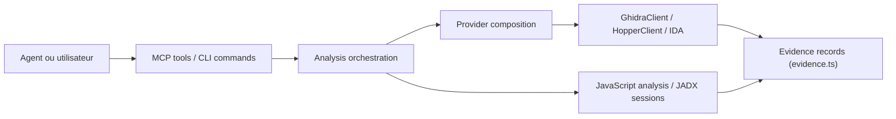

# morluto/rea

> Serveur MCP et CLI qui font analyser par un agent des binaires, apps Electron, APK et sites, localement.

## Le problème
Comprendre comment une fonctionnalité d'une application fermée est construite exige d'enchaîner à la main décompilateurs, inspecteurs de formats et captures réseau.

## Ce que ça fait vraiment
REA expose via MCP et CLI une grande table de cibles : binaires natifs (Hopper, Ghidra ou IDA), JavaScript/Electron, .NET, APK (JADX), sites web, captures réseau, firmware, SQLite, modèles GGUF. Chaque résultat revient avec ses preuves et ses limites. L'analyse tourne en local ; l'agent reçoit les résultats. Setup enregistre le MCP et des instructions de workflow dans Claude Code, Codex, Cursor, Gemini CLI.

## Comment c'est branché


## Essayer
```bash
npx rea-agents setup
npx -y rea-agents@latest analyze-javascript-application /absolute/path/to/app --json
npm install --global rea-agents
rea --help
```

## Coût et pièges
Gratuit ; Node.js 22.x/24.x/26.x requis, selon la cible un outil tiers (Hopper, Ghidra, IDA, JADX, tshark…). Sous Linux, un `ps` compatible procps est exigé. Setup modifie la config de vos agents (avec sauvegardes).

## Ce que ce n'est pas
Pas un outil autonome : il faut un agent ou la CLI et souvent un moteur natif installé à part. Le runtime capture exécute la cible avec vos droits. Le README impose un usage licite (analyse de logiciels autorisés) ; l'étoile-compteur très élevée (372 k) ne dit rien de la maturité.

## Alternatives
- Ghidra, Hopper, IDA : les moteurs que REA pilote, à utiliser seuls si pas d'agent.
- GNU objdump et Rizin : providers hors-ligne supportés par REA.
- JADX / Apktool : pour l'Android seul.

## Pour toi
À surveiller : utile si tu fais de la rétro-ingénierie assistée par agent, hors du cœur data/MLOps ; seule exception, l'inspection d'artefacts de modèles GGUF/safetensors.

