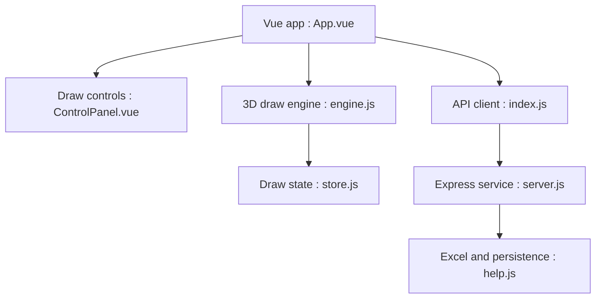

# moshang-ax/lottery

> Prize-draw program for an annual dinner, with a 3D sphere of names and Excel import and export.

## The problem
Run a company prize draw with configurable prizes.

## What it actually does
A Vue 3 + Vite frontend with Three.js (CSS3D) for the sphere of names, and a Node/Express server that reads the participant list from `server/data/user.xlsx` and records the winners. Prizes are configured in `server/config.js`. Results can be exported to Excel. A Docker deployment is described.

## How it is wired


## Trying it
```bash
git clone https://github.com/moshang-xc/lottery.git
cd lottery/server && npm install
cd ../product && npm install
npm run build
npm run serve
```

## Cost and gotchas
Free. The Docker README mentions ports 8888 and 443. The clone URL in the README differs from the name of the cataloged repo.

## What it is not
Not an analytics or AI tool: an event entertainment application.

## Alternatives
No alternative named in the README.

## For you
Ignore: no data/AI/MLOps use, except to liven up a team event.
