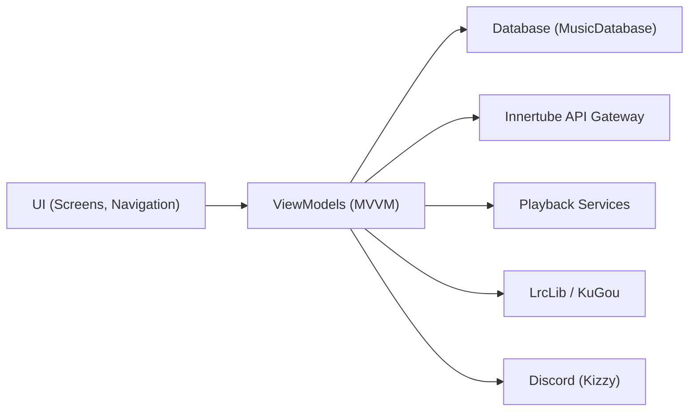

# mostafaalagamy/Metrolist

> Android client for YouTube Music, with synced lyrics, offline playback and shared listening.

## The problem
The official app forces ads, a subscription and limited features for background listening.

## What it actually does
Android MVVM application split into modules: `app` (UI, viewmodels, MusicDatabase, playback service), `innertube` (access to the YouTube Music API), `lrclib` and `kugou` (lyrics), `kizzy` (Discord), `material-color-utilities` (theme). Features: offline cache, equalizer, crossfade, Last.fm, AI lyrics translation. The project is in maintenance mode: fixes only.

## How it is wired

## Trying it
No documented command: the README points to downloads (Obtainium, IzzyOnDroid, GitHub).

## Cost and gotchas
Free. Depends on YouTube Music: without a VPN, it does not work in a region that is not covered. Maintenance mode: no new features.

## What it is not
Not affiliated with YouTube or Google, the README states. Not a standalone alternative: the content comes from YouTube.

## Alternatives
- InnerTune and OuterTune: projects Metrolist draws inspiration from.

## For you
Ignore: consumer application unrelated to data/AI, tied to an unofficial API.
