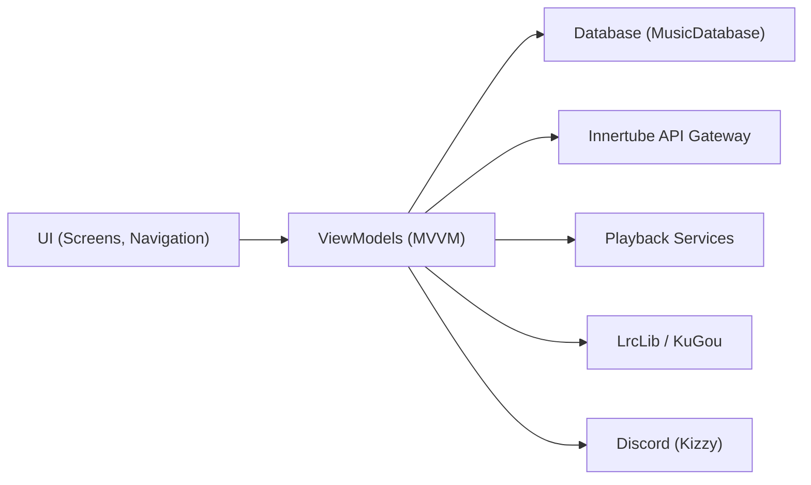

# mostafaalagamy/Metrolist

> Client Android pour YouTube Music, avec paroles synchronisées, hors-ligne et écoute partagée.

## Le problème
L'application officielle impose pubs, abonnement et fonctions limitées pour écouter en arrière-plan.

## Ce que ça fait vraiment
Application Android MVVM en modules : `app` (UI, viewmodels, base MusicDatabase, service de lecture), `innertube` (accès à l'API YouTube Music), `lrclib` et `kugou` (paroles), `kizzy` (Discord), `material-color-utilities` (thème). Fonctions : cache hors-ligne, égaliseur, crossfade, Last.fm, traduction de paroles par IA. Le projet est en mode maintenance : correctifs seulement.

## Comment c'est branché

## Essayer
Aucune commande documentée : le README renvoie vers des téléchargements (Obtainium, IzzyOnDroid, GitHub).

## Coût et pièges
Gratuit. Dépend de YouTube Music : sans VPN, il ne marche pas dans une région non couverte. Mode maintenance : pas de nouvelles fonctions.

## Ce que ce n'est pas
Pas affilié à YouTube ni à Google, précise le README. Pas une alternative autonome : le contenu vient de YouTube.

## Alternatives
- InnerTune et OuterTune : projets dont Metrolist s'inspire.

## Pour toi
Ignorer : application grand public sans lien avec la data/IA, liée à une API non officielle.

