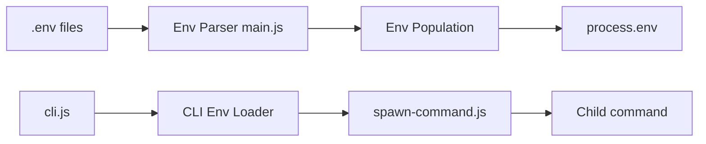

# motdotla/dotenv

> Loads variables from a .env file into process.env, with no dependencies, for Node apps.

## The problem
Keep configuration and secrets out of the code (12-factor principle) without exporting them by hand at every launch.

## What it actually does
`config()` reads `.env`, parses it and fills `process.env` without overwriting existing values (unless `override`). Options: path(s), encoding, debug, quiet mode, fast parser, alternate target. New CLI `dotenv run -- cmd` that launches a command with the file loaded. Variable expansion, encryption and multi-environment are delegated to the sibling tool dotenvx.

## How it is wired


## Trying it
```bash
npm install dotenv --save
npx dotenv run -- node index.js
dotenv run --file .env.local,.env node index.js
```

## Cost and gotchas
Free. Do not commit `.env` (unless encrypted with dotenvx). Since v15, `#` starts a comment unless the value is quoted.

## What it is not
Not a secrets manager: the file stays in plain text, and variable expansion is not included.

## Alternatives
dotenvx: expansion, encryption, multi-environment.

## For you
Standard reflex for any Node service that uses API keys (LLMs, databases); in Python, the equivalent is not this repository.
