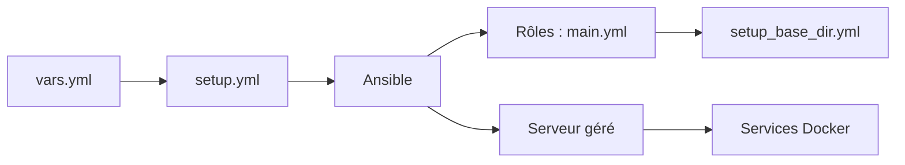

# mother-of-all-self-hosting/mash-playbook

> Single Ansible playbook to self-host many services in Docker containers on your own server.

## The problem
Maintaining one playbook per service (Matrix, Nextcloud, Gitea...) duplicates Postgres, Traefik, backups and documentation.

## What it actually does
A single playbook brings the services together: you prepare `vars.yml`, run `setup.yml` and Ansible installs and updates the containers, with shared Postgres, reverse proxy and backups. A Python utility (`optimize.py`) filters the playbook's entries according to the configured variables. The Matrix playbook remains separate.

## How it is wired

## Trying it
The README gives no command: it points to the `docs/` folder for installation.

## Cost and gotchas
Free; a server of your own and Ansible experience. Breaking changes happen: read the changelog before each update.

## What it is not
Not a graphical interface nor a managed service. Not a single point of failure to avoid: the README advises spreading across several servers.

## Alternatives
No alternative named in the README.

## For you
Worth watching: useful for setting up a homelab or a team server, but little related to data/MLOps work; note the AGPL for any redistribution.
