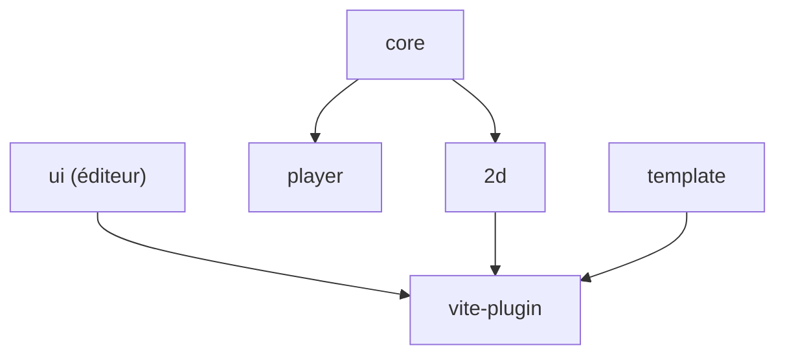

# motion-canvas/motion-canvas

> TypeScript library and editor for programming vector animations synchronized with a voice-over.

## The problem
Producing explanatory animations synchronized with sound requires heavy, hard-to-reproduce editing tools.

## What it actually does
Animations are written in TypeScript using generators. An editor with real-time preview lets you adjust what would be tedious in code. The monorepo contains `core`, `2d`, `ui`, `player`, `vite-plugin` and a project template.

## How it is wired
Simplified diagram based on the sheet, no diagram provided.



## Trying it
```bash
npm install
npx lerna run build
npm run template:dev
```

## Cost and gotchas
Free (MIT). Node required. These commands are for local development of the repo; the getting-started guide is on the website. Last push in July 2026.

## What it is not
Not a general-purpose video editor: it targets informative vector animations, not editing of raw footage.

## Alternatives
No alternative named in the README.

## For you
Worth watching: handy for producing explainer videos of your data projects as version-controlled code, no critical stakes.
