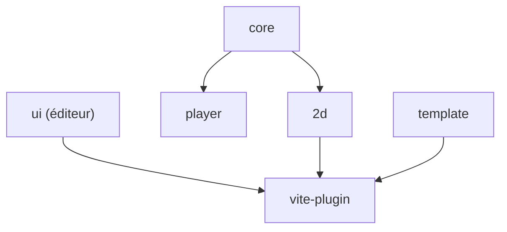

# motion-canvas/motion-canvas

> Bibliothèque TypeScript et éditeur pour programmer des animations vectorielles synchronisées avec une voix off.

## Le problème
Produire des animations explicatives synchronisées au son demande des outils de montage lourds et peu reproductibles.

## Ce que ça fait vraiment
Les animations s'écrivent en TypeScript avec des générateurs. Un éditeur avec aperçu en temps réel permet d'ajuster ce qui serait fastidieux dans le code. Le monorepo contient `core`, `2d`, `ui`, `player`, `vite-plugin` et un modèle de projet.

## Comment c'est branché
Schéma simplifié d'après la fiche, sans diagramme fourni.



## Essayer
```bash
npm install
npx lerna run build
npm run template:dev
```

## Coût et pièges
Gratuit (MIT). Node requis. Ces commandes sont celles du développement local du dépôt ; le guide de démarrage est sur le site. Dernier push en juillet 2026.

## Ce que ce n'est pas
Pas un éditeur vidéo généraliste : il vise les animations vectorielles informatives, pas le montage de rushes.

## Alternatives
Aucune alternative nommée dans le README.

## Pour toi
À surveiller : pratique pour produire des vidéos explicatives de tes projets data en code versionné, sans enjeu critique.

