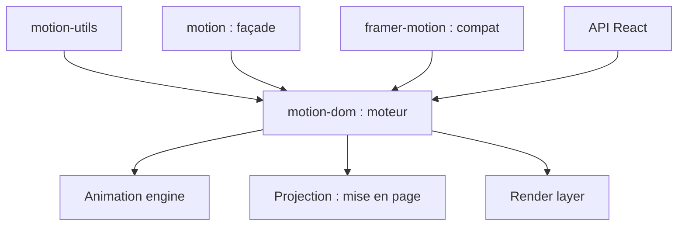

# motiondivision/motion

> Animation library for JavaScript, React and Vue (formerly Framer Motion), for front-end developers.

## The problem
Animating an interface (gestures, layout transitions, scrolling) by hand in CSS and JavaScript is slow.

## What it actually does
A hybrid engine mixes JavaScript and native browser APIs (WAAPI). It provides springs, gestures (drag, hover, pan), layout transitions and scroll-linked animations. A React API (`motion/react`), a JavaScript API and a Vue package exist. `npx motion-ai` installs an agent skill and an MCP server.

## How it is wired


## Trying it
```bash
npm install motion
npm install motion-v
npx motion-ai
```
```jsx
import { motion } from "motion/react"
```

## Cost and gotchas
The core is free (MIT). Motion+ (examples, premium API, editor) is paid: a single personal license or an annual per-seat plan. Motion Studio is a separate product.

## What it is not
Not a tool for data or AI. Not entirely free if you want the examples and premium APIs. Framer Motion has become Motion: the import changes.

## Alternatives
No alternative named in the README.

## For you
Ignore: interface animation unrelated to data / AI / MLOps work, except to decorate a web dashboard.
