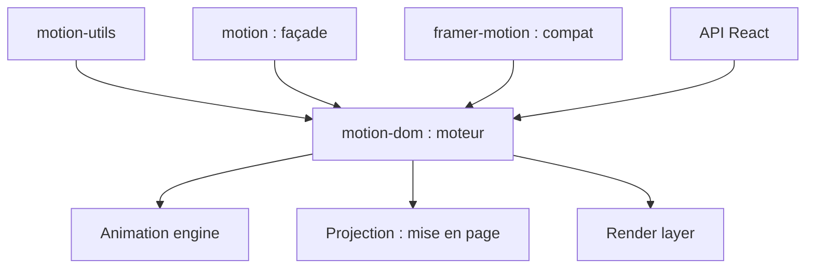

# motiondivision/motion

> Bibliothèque d'animation pour JavaScript, React et Vue (ex-Framer Motion), pour développeurs front.

## Le problème
Animer une interface (gestes, transitions de mise en page, défilement) à la main en CSS et JavaScript est long.

## Ce que ça fait vraiment
Un moteur hybride mêle JavaScript et API natives du navigateur (WAAPI). Il fournit ressorts, gestes (drag, hover, pan), transitions de mise en page et animations liées au défilement. Une API React (`motion/react`), une API JavaScript et un paquet Vue existent. `npx motion-ai` installe un skill d'agent et un serveur MCP.

## Comment c'est branché


## Essayer
```bash
npm install motion
npm install motion-v
npx motion-ai
```
```jsx
import { motion } from "motion/react"
```

## Coût et pièges
Le cœur est gratuit (MIT). Motion+ (exemples, API premium, éditeur) est payant : licence personnelle unique ou plan annuel par poste. Motion Studio est un produit à part.

## Ce que ce n'est pas
Pas un outil pour la donnée ni l'IA. Pas entièrement gratuit si tu veux les exemples et API premium. Framer Motion est devenu Motion : l'import change.

## Alternatives
Aucune alternative nommée dans le README.

## Pour toi
À ignorer : animation d'interface sans lien avec un travail data / IA / MLOps, sauf pour décorer un tableau de bord web.

