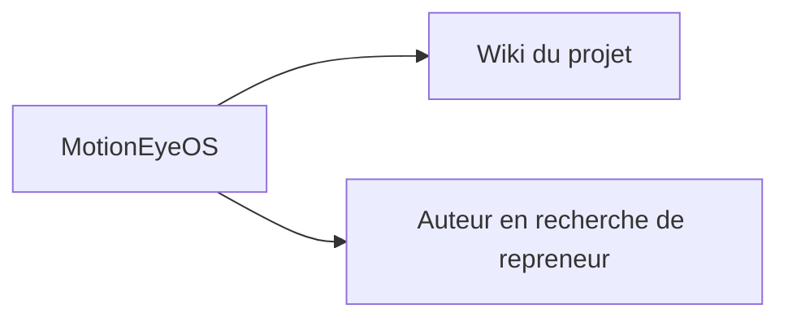

# motioneye-project/motioneyeos

> Linux distribution that turns a single-board computer into a video surveillance system.

## The problem
Setting up a surveillance camera on a Raspberry Pi takes a lot of assembly.

## What it actually does
Insufficient material: the README is two sentences long and points to the wiki. It states that the author can no longer be involved and is looking for a successor.

## How it is wired
Simplified diagram based on the sheet, no diagram provided.



## Trying it
```bash
# non documenté dans le README fourni (voir le wiki)
```

## Cost and gotchas
Free. Last push February 2025, 841 open issues.

## What it is not
Not an actively maintained project. A license is present but not identified by GitHub.

## Alternatives
No alternative named.

## For you
Ignore: effectively abandoned, unrelated to data/AI/MLOps.
