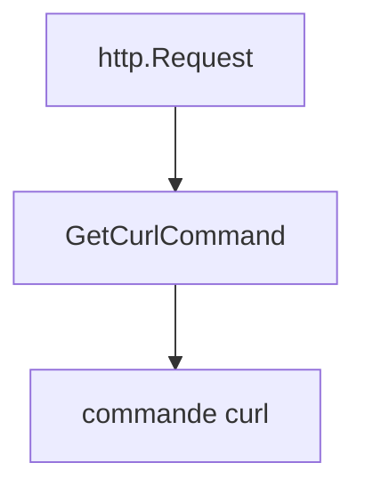

# moul/http2curl

> Go library that converts an http.Request into a curl command line, for debugging.

## The problem
Reproducing in a terminal a request built in Go forces you to retype the URL, headers and body by hand.

## What it actually does
Provides `GetCurlCommand(req)`, which returns the equivalent curl command (method, body, headers, URL). The README cites repos that use it, including gorequest, scaleway-cli and httpexpect.

## How it is wired


## Trying it
```bash
go get moul.io/http2curl
```
```go
command, _ := http2curl.GetCurlCommand(req)
fmt.Println(command)
```

## Cost and gotchas
Free. License present but not identified: check before use.

## What it is not
Not the reverse operation (the README points to mholt/curl-to-go). Covers only what the README shows.

## Alternatives
- mholt/curl-to-go: for going from curl to Go code.

## For you
Worth watching: handy for tracing API calls in Go, but unrelated to data; the unclear license needs checking.
