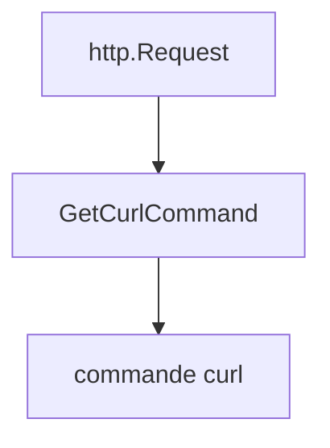

# moul/http2curl

> Bibliothèque Go qui convertit une requête http.Request en ligne de commande curl, pour déboguer.

## Le problème
Reproduire dans un terminal une requête construite en Go oblige à retranscrire à la main URL, en-têtes et corps.

## Ce que ça fait vraiment
Fournit `GetCurlCommand(req)` qui renvoie la commande curl équivalente (méthode, corps, en-têtes, URL). Le README cite des dépôts qui l'utilisent, dont gorequest, scaleway-cli et httpexpect.

## Comment c'est branché


## Essayer
```bash
go get moul.io/http2curl
```
```go
command, _ := http2curl.GetCurlCommand(req)
fmt.Println(command)
```

## Coût et pièges
Gratuit. Licence présente mais non identifiée : à vérifier avant usage.

## Ce que ce n'est pas
Pas l'opération inverse (le README renvoie vers mholt/curl-to-go). Ne couvre que ce que le README montre.

## Alternatives
- mholt/curl-to-go : pour passer de curl à du code Go.

## Pour toi
À surveiller : pratique pour tracer des appels d'API en Go, mais sans lien avec la data ; la licence floue demande vérification.

