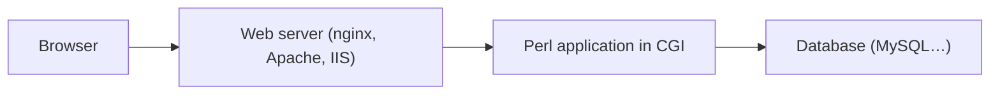

# movabletype/movabletype

> A self-hosted blog and site management system written in Perl.

## The problem
Publishing and managing blogs and websites with a self-hosted CMS.

## What it actually does
A Perl application (5.16.3+) run as CGI on nginx, Apache, or IIS with a database such as MySQL. Installed by uploading files into an `mt` folder, with a browser-based setup wizard; updated by overwriting after a backup. The README only describes installation.

## How it is wired
Simplified diagram based on the fiche, no diagram provided.

## Trying it
No command documented: upload the files to the server, enable CGI execution, and open `/mt/`.

## Cost and gotchas
No license declared in the catalog. Back up the database before updating; `mt-static` sometimes needs to be moved out of `cgi-bin`.

## What it is not
Not a modern serverless application: it assumes CGI, Perl, and a database.

## Alternatives
No alternative named in the README.

## For you
To ignore: a Perl CMS, unrelated to data/AI/MLOps.
