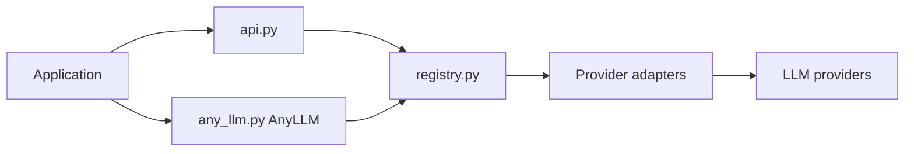

# mozilla-ai/any-llm

> Python SDK with a single interface to many LLM providers, no proxy, for application developers.

## The problem
Each provider has its own parameter and response variants; switching models forces you to rewrite code.

## What it actually does
A `completion` function (and `responses`, async version) with `provider` and `model`, or the `AnyLLM` class which reuses the client. Relies on the providers' official SDKs, with full typing. Pip extras per provider. Migration path from LiteLLM: change the import and the `provider:model` string. Optional separate gateway (Otari).

## How it is wired


## Trying it
```bash
pip install 'any-llm-sdk[mistral,ollama]'
export MISTRAL_API_KEY="YOUR_KEY_HERE"
```
```python
from any_llm import completion
response = completion(model="mistral-small-latest", provider="mistral",
                      messages=[{"role": "user", "content": "Hello!"}])
```

## Cost and gotchas
Keys at your expense with each provider. Python 3.11+.

## What it is not
Not a gateway: no budget, multi-tenancy or proxy (points to mozilla-ai/otari). Not an agent framework.

## Alternatives
LiteLLM: better known but reimplements the interfaces; AISuite: not actively maintained according to the README; OpenRouter/Portkey: hosted proxies.

## For you
Adopt for scripts and services that must switch provider without rewriting: Apache-2.0, official SDKs, active publisher.
