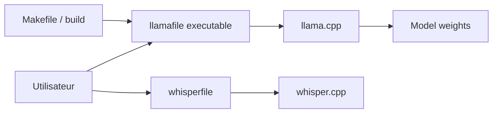

# mozilla-ai/llamafile

> Distributes and runs a local LLM in a single executable file, for developers and users.

## The problem
Running an open model locally requires installation, dependencies and runtime choices.

## What it actually does
Combines llama.cpp and Cosmopolitan Libc to produce a single executable that embeds the model weights, with no installation, on most OSes and CPU architectures. Also includes whisperfile (audio transcription/translation with whisper.cpp). Since 0.10, a new build system aligned with llama.cpp, with a few features of the old version missing.

## How it is wired


## Trying it
```bash
curl -LO https://huggingface.co/mozilla-ai/llamafile_0.10/resolve/main/Qwen3.5-0.8B-Q8_0.llamafile
chmod +x Qwen3.5-0.8B-Q8_0.llamafile
./Qwen3.5-0.8B-Q8_0.llamafile
```

## Cost and gotchas
Free; RAM depends on the model. On Windows, only executables under 4 GB run. The license is not identified by GitHub: the README speaks of Apache 2.0 with MIT modifications on llama.cpp and whisper.cpp.

## What it is not
Not a service nor a hosted API; an executable to run locally.

## Alternatives
No alternative named in the README (it builds on llama.cpp and whisper.cpp).

## For you
The simplest way to test a local LLM or hand a model to a colleague without installation; check the license before commercial use.
